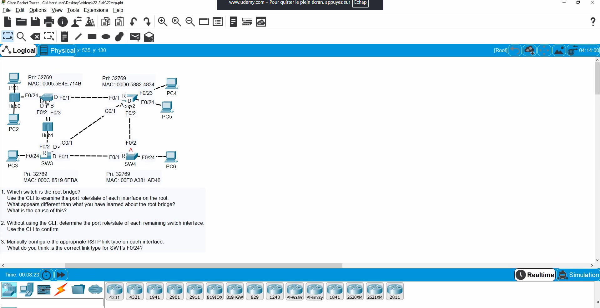

# Rapid Spanning Tree Protocol (RSTP) Lab

---

# Objective

Practice the operation of Rapid Spanning Tree Protocol (RSTP) by:

- Identifying the Root Bridge
- Determining port roles and states
- Configuring RSTP link types
- Understanding Edge, Point-to-Point, and Shared links
- Comparing STP and RSTP behavior

---

# Topology

Devices

- SW1
- SW2
- SW3
- SW4
- Hub0
- Hub1

Hosts

- PC1
- PC2
- PC3
- PC4
- PC5
- PC6

RSTP Mode

Rapid PVST+

---

# Task 1

Determine the current Root Bridge.

Commands

```cisco
show spanning-tree

show spanning-tree root
```

Verify

- Root Bridge
- Root Ports
- Designated Ports
- Alternate Ports

---

# Task 2

Determine the role and state of every interface.

Possible Roles

- Root Port (RP)
- Designated Port (DP)
- Alternate Port (AP)
- Backup Port (BP)

Possible States

- Discarding
- Learning
- Forwarding

Verification

```cisco
show spanning-tree
```

---

# Task 3

Configure RSTP Link Types

Possible Link Types

- Edge
- Point-to-Point
- Shared

Example

```cisco
interface fa0/24
spanning-tree portfast
```

---

# RSTP Link Types

## Edge Port

Connected directly to an end device.

Immediately enters Forwarding state.

Equivalent to PortFast.

---

## Point-to-Point Link

Connection between two switches.

Supports rapid convergence.

Normally full-duplex.

---

## Shared Link

Connection through a hub.

Cannot perform Proposal/Agreement.

Uses legacy STP behavior.

---

# Verification Commands

```cisco
show spanning-tree

show spanning-tree detail

show spanning-tree interface

show spanning-tree root

show spanning-tree summary
```

---

# Expected Results

✔ One Root Bridge

✔ One Root Port per non-root switch

✔ Designated Ports forwarding traffic

✔ Alternate Ports ready for failover

✔ Shared links using legacy behavior

✔ Edge ports forwarding immediately

---

# Key Concepts Learned

- Rapid PVST+
- Root Bridge Election
- Root Port
- Designated Port
- Alternate Port
- Backup Port
- Edge Port
- Shared Link
- Point-to-Point Link
- Proposal / Agreement
- Fast Convergence

---

# STP vs RSTP

| STP | RSTP |
|------|------|
| IEEE 802.1D | IEEE 802.1w |
| 30-50 s convergence | <1-6 s convergence |
| 5 states | 3 states |
| Uses timers | Uses Proposal/Agreement |
| No Alternate Port | Alternate Port available |

---

# Screenshot


