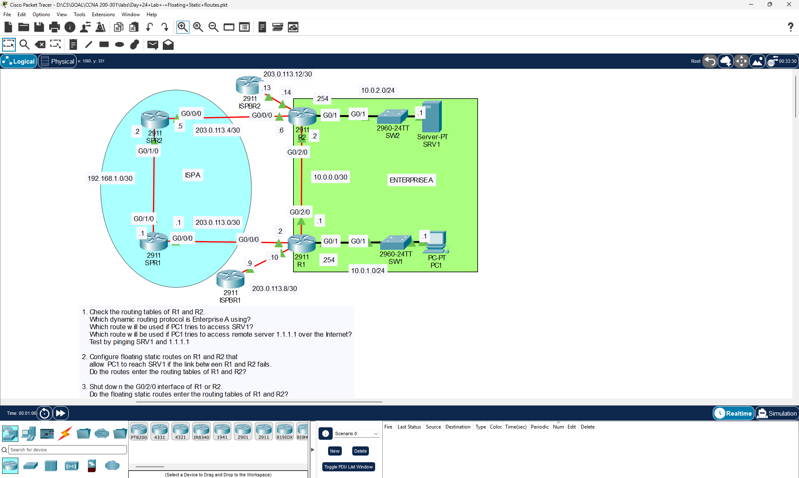

# Day 24 – Floating Static Routes Lab

## 1. Objective

Configure and verify Floating Static Routes to provide backup connectivity when the primary link between two routers fails.

### Learning Objectives

- Analyze routing tables
- Identify dynamic routing protocols
- Understand Administrative Distance (AD)
- Configure Floating Static Routes
- Test network failover
- Verify routing table changes
- Understand primary and backup routes

---

## 2. Network Topology



### Enterprise A Networks

| Network | Subnet |
|---|---|
| R1 LAN | 10.0.1.0/24 |
| R2 LAN | 10.0.2.0/24 |
| R1–R2 Direct Link | 10.0.0.0/30 |

### ISP Connections

| Connection | Network |
|---|---|
| R1–ISPR1 | 203.0.113.8/30 |
| R2–ISPR2 | 203.0.113.12/30 |
| ISPR1–ISPR2 | 192.168.1.0/30 |
| ISPR1–SPR1 | 203.0.113.0/30 |
| ISPR2–SPR2 | 203.0.113.4/30 |

---

## 3. Task 1 – Analyze Routing Tables

Check the routing tables of R1 and R2.

```cisco
show ip route
show ip protocols
```

### Questions

1. Which dynamic routing protocol is Enterprise A using?
2. Which route is used when PC1 accesses SRV1?
3. Which route is used when PC1 accesses 1.1.1.1 over the Internet?

### How to identify the protocol

Routing table codes:

| Code | Protocol |
|---|---|
| C | Connected |
| L | Local |
| S | Static |
| R | RIP |
| D | EIGRP |
| O | OSPF |

**Important:** Identify the actual routing protocol from the router's routing table. Do not assume it before verification.

### Test connectivity

From PC1:

```text
ping 10.0.2.1
ping 1.1.1.1
```

Record the initial results.

---

## 4. Task 2 – Configure Floating Static Routes

### What is a Floating Static Route?

A Floating Static Route is a static route configured with an Administrative Distance higher than the primary route.

It remains a backup while a preferred route is available.

### Example

Primary route learned through OSPF:

```text
O 10.0.2.0/24 [110/2] via 10.0.0.2
```

Backup static route:

```text
S 10.0.2.0/24 [120/0] via 203.0.113.9
```

The OSPF route is preferred because AD 110 is lower than AD 120.

Note: This is an illustrative example. The actual protocol and metric must be checked in Packet Tracer.

### R1 Configuration

Configure a backup route to R2's LAN through ISPR1:

```cisco
enable
configure terminal

ip route 10.0.2.0 255.255.255.0 203.0.113.9 200

end
write memory
```

Explanation:

- Destination: 10.0.2.0/24
- Next hop: 203.0.113.9 (ISPR1)
- Administrative Distance: 200

### R2 Configuration

Configure a backup route to R1's LAN through ISPR2:

```cisco
enable
configure terminal

ip route 10.0.1.0 255.255.255.0 203.0.113.13 200

end
write memory
```

Explanation:

- Destination: 10.0.1.0/24
- Next hop: 203.0.113.13 (ISPR2)
- Administrative Distance: 200

**Important:** AD 200 is an example appropriate only if the primary route has a lower AD. Confirm the existing routing protocol before applying the configuration.

---

## 5. Task 3 – Verify Backup Routes

Check the routing table:

```cisco
show ip route
show ip route static
show running-config | include ip route
```

### Expected Result

While the primary dynamic route is active:

- The primary route remains preferred.
- The floating static route is configured.
- The floating route does not normally appear as the selected route in the routing table.

---

## 6. Task 4 – Simulate Link Failure

Disable the direct connection between R1 and R2.

On R1:

```cisco
enable
configure terminal

interface g0/2/0
shutdown

end
```

Alternatively, shut down the corresponding interface on R2.

### Verify

```cisco
show ip interface brief
show ip route
```

### Expected Result

If the primary route disappears and the backup next hop remains reachable, the Floating Static Route should become active.

R1 backup path:

```text
R1 → ISPR1 → ISP Network → ISPR2 → R2
```

R2 backup path:

```text
R2 → ISPR2 → ISP Network → ISPR1 → R1
```

**Note:** Both ISP routers must have the necessary routes for the return traffic.

---

## 7. Task 5 – Test Connectivity

From PC1:

```text
ping 10.0.2.1
tracert 10.0.2.1
```

Verify:

- PC1 can reach SRV1.
- Traffic uses the backup ISP path.
- The floating static routes are active.
- Return traffic can reach PC1.

---

## 8. Task 6 – Restore the Primary Link

On R1:

```cisco
configure terminal

interface g0/2/0
no shutdown

end
```

Verify:

```cisco
show ip route
show ip interface brief
```

### Expected Result

After the primary route is restored:

- The primary route becomes preferred again.
- The floating static route returns to standby.
- Traffic uses the primary path.

---

## 9. Administrative Distance

Administrative Distance determines which route source is preferred for the same destination prefix.

| Route Source | Default AD |
|---|---:|
| Connected | 0 |
| Static | 1 |
| EIGRP Internal | 90 |
| OSPF | 110 |
| RIP | 120 |
| EIGRP External | 170 |

### Floating Static Route

```cisco
ip route <network> <mask> <next-hop> <AD>
```

Example:

```cisco
ip route 10.0.2.0 255.255.255.0 203.0.113.9 200
```

---

## 10. Troubleshooting Commands

```cisco
show ip route
show ip route static
show ip protocols
show ip interface brief
show running-config
ping 10.0.2.1
traceroute 10.0.2.1
```

---

## 11. Key Concepts Learned

- Static Routing
- Dynamic Routing
- Floating Static Routes
- Administrative Distance
- Primary Route
- Backup Route
- Routing Failover
- Route Convergence
- Network Redundancy
- Routing Table Verification

---

## 12. Conclusion

Floating Static Routes provide a simple mechanism for network redundancy.

By assigning a higher Administrative Distance to backup static routes, routers can prefer a primary dynamic route and switch to an alternative path when the primary route becomes unavailable.

This lab demonstrates how to configure and verify backup connectivity between enterprise networks through an ISP infrastructure.
