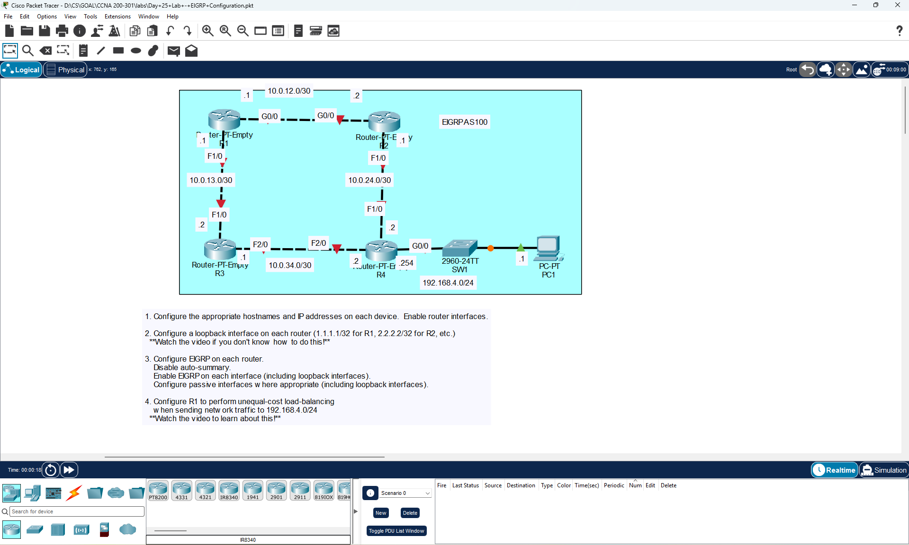

# Day 25 – EIGRP Configuration Lab

## 1. Objectives

Configure Enhanced Interior Gateway Routing Protocol (EIGRP) on four Cisco routers.

Learning objectives:

- Configure router hostnames and IP addresses
- Create Loopback interfaces
- Configure EIGRP Autonomous System 100
- Disable automatic summarization
- Advertise networks using EIGRP
- Configure passive interfaces
- Verify EIGRP neighbors and routing tables
- Configure unequal-cost load balancing using variance

---

## 2. Network Topology



### Network Addressing

| Connection | Network | Router A | Router B |
|---|---|---|---|
| R1–R2 | 10.0.12.0/30 | R1: .1 | R2: .2 |
| R1–R3 | 10.0.13.0/30 | R1: .1 | R3: .2 |
| R2–R4 | 10.0.24.0/30 | R2: .1 | R4: .2 |
| R3–R4 | 10.0.34.0/30 | R3: .1 | R4: .2 |
| R4 LAN | 192.168.4.0/24 | R4: .254 | PC1: .1 |

### Loopback Addresses

| Router | Loopback0 |
|---|---|
| R1 | 1.1.1.1/32 |
| R2 | 2.2.2.2/32 |
| R3 | 3.3.3.3/32 |
| R4 | 4.4.4.4/32 |

EIGRP Autonomous System: 100

---

## 3. Task 1 – Basic Router Configuration

### R1

```cisco
enable
configure terminal
hostname R1

interface g0/0
 ip address 10.0.12.1 255.255.255.252
 no shutdown
exit

interface f1/0
 ip address 10.0.13.1 255.255.255.252
 no shutdown
exit

interface loopback 0
 ip address 1.1.1.1 255.255.255.255
exit
```

### R2

```cisco
enable
configure terminal
hostname R2

interface g0/0
 ip address 10.0.12.2 255.255.255.252
 no shutdown
exit

interface f1/0
 ip address 10.0.24.1 255.255.255.252
 no shutdown
exit

interface loopback 0
 ip address 2.2.2.2 255.255.255.255
exit
```

### R3

```cisco
enable
configure terminal
hostname R3

interface f1/0
 ip address 10.0.13.2 255.255.255.252
 no shutdown
exit

interface f2/0
 ip address 10.0.34.1 255.255.255.252
 no shutdown
exit

interface loopback 0
 ip address 3.3.3.3 255.255.255.255
exit
```

### R4

```cisco
enable
configure terminal
hostname R4

interface f1/0
 ip address 10.0.24.2 255.255.255.252
 no shutdown
exit

interface f2/0
 ip address 10.0.34.2 255.255.255.252
 no shutdown
exit

interface g0/0
 ip address 192.168.4.254 255.255.255.0
 no shutdown
exit

interface loopback 0
 ip address 4.4.4.4 255.255.255.255
exit
```

### PC1 Configuration

IP address: 192.168.4.1

Subnet mask: 255.255.255.0

Default gateway: 192.168.4.254

---

## 4. Task 2 – Configure EIGRP

### R1

```cisco
router eigrp 100
 no auto-summary
 network 10.0.12.0 0.0.0.3
 network 10.0.13.0 0.0.0.3
 network 1.1.1.1 0.0.0.0
 passive-interface loopback 0
```

### R2

```cisco
router eigrp 100
 no auto-summary
 network 10.0.12.0 0.0.0.3
 network 10.0.24.0 0.0.0.3
 network 2.2.2.2 0.0.0.0
 passive-interface loopback 0
```

### R3

```cisco
router eigrp 100
 no auto-summary
 network 10.0.13.0 0.0.0.3
 network 10.0.34.0 0.0.0.3
 network 3.3.3.3 0.0.0.0
 passive-interface loopback 0
```

### R4

```cisco
router eigrp 100
 no auto-summary
 network 10.0.24.0 0.0.0.3
 network 10.0.34.0 0.0.0.3
 network 192.168.4.0 0.0.0.255
 network 4.4.4.4 0.0.0.0
 passive-interface g0/0
 passive-interface loopback 0
```

### Important Concepts

`router eigrp 100`

Enables EIGRP Autonomous System 100.

`network`

Enables EIGRP on matching interfaces and advertises their connected networks.

`no auto-summary`

Disables automatic classful route summarization in classic EIGRP.

`passive-interface`

Prevents EIGRP neighbor formation on an interface while allowing its connected network to be advertised.

---

## 5. Task 3 – Verify EIGRP Neighbors

Run:

```cisco
show ip eigrp neighbors
```

Expected neighbor relationships:

| Router | Neighbors |
|---|---|
| R1 | R2, R3 |
| R2 | R1, R4 |
| R3 | R1, R4 |
| R4 | R2, R3 |

If a neighbor is missing, check:

- Interface status
- IP addressing
- EIGRP AS number
- Network statements
- Passive-interface configuration
- EIGRP metric compatibility

---

## 6. Task 4 – Verify EIGRP Routes

```cisco
show ip route
show ip route eigrp
show ip protocols
```

EIGRP route code:

D = Internal EIGRP route

Example:

```text
D 192.168.4.0/24 [90/metric] via 10.0.12.2
```

Administrative Distance:

Internal EIGRP = 90

External EIGRP = 170

The metric depends on the configured bandwidth and delay values.

---

## 7. Task 5 – EIGRP Topology Table

Command:

```cisco
show ip eigrp topology
```

Important concepts:

### Successor

The best loop-free next hop toward a destination.

### Feasible Successor

A loop-free backup path satisfying the feasibility condition.

### Feasible Distance (FD)

The lowest calculated metric from the local router to the destination.

### Reported Distance (RD)

The metric advertised by a neighbor toward the destination.

### Feasibility Condition

A neighbor can qualify as a feasible successor when:

RD < Local FD

---

## 8. Task 6 – Unequal-Cost Load Balancing

EIGRP supports unequal-cost load balancing using the `variance` command.

### Configuration on R1

```cisco
router eigrp 100
 variance 2
```

The variance multiplier allows additional feasible routes to be installed when their metric is within the permitted range.

Important:

- Variance is configured under EIGRP.
- The additional route must satisfy the feasibility condition.
- Its metric must be within the variance threshold.
- `maximum-paths` controls the number of eligible installed paths.

### Verification

```cisco
show ip route 192.168.4.0
show ip eigrp topology 192.168.4.0/24
show ip protocols
```

### Expected Result

R1 may install routes through both R2 and R3 if the EIGRP feasibility and variance conditions are satisfied.

If both paths are not installed, inspect the actual metrics and reported distances before changing the configuration.

---

## 9. Connectivity Testing

From R1:

```cisco
ping 192.168.4.1
ping 4.4.4.4
traceroute 192.168.4.1
```

From PC1:

```text
ping 1.1.1.1
ping 2.2.2.2
ping 3.3.3.3
ping 4.4.4.4
```

Verify connectivity between all routers and the LAN.

---

## 10. Troubleshooting Commands

```cisco
show ip interface brief
show ip route
show ip route eigrp
show ip protocols
show ip eigrp neighbors
show ip eigrp topology
show running-config
```

---

## 11. Key Concepts Learned

- EIGRP
- Autonomous System
- Neighbor Adjacency
- Network Statements
- Wildcard Masks
- Passive Interfaces
- Loopback Interfaces
- DUAL Algorithm
- Successor
- Feasible Successor
- Feasible Distance
- Reported Distance
- Feasibility Condition
- Variance
- Unequal-Cost Load Balancing

---

## 12. Conclusion

This lab demonstrates how EIGRP dynamically exchanges routing information between Cisco routers.

It also introduces unequal-cost load balancing, allowing EIGRP to use multiple eligible paths toward the same destination.

EIGRP provides dynamic route discovery, redundancy, and efficient convergence through the DUAL algorithm.
